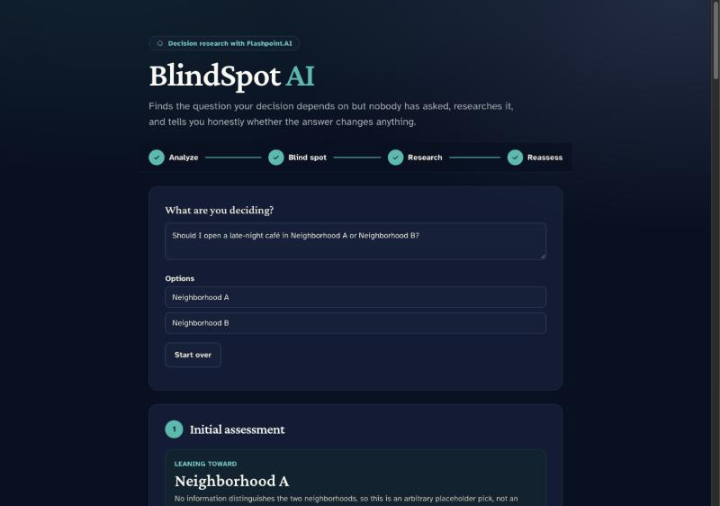
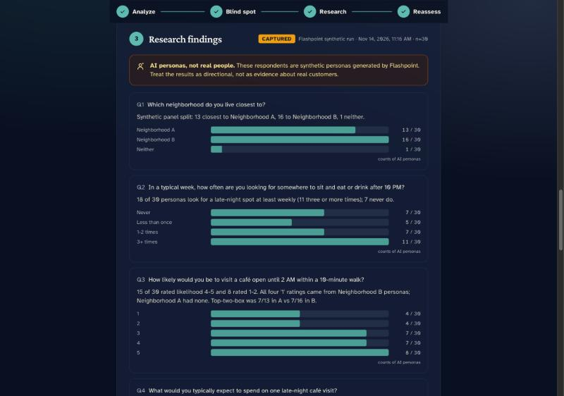
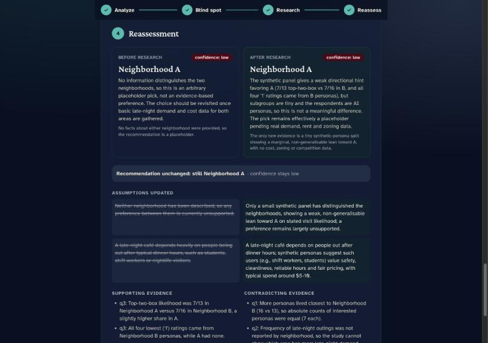

# BlindSpot AI

An AI decision-research agent that recognizes what it does *not* know. It finds the unknown your decision hinges on, researches it with a [Flashpoint.AI](https://flashpoint.ai) synthetic panel, and tells you honestly whether the answer changes anything.

Built for *Hack the Unreachable* (Flashpoint.AI), Self-Improving AI track, by Chinmay Naringrekar and Dolly Lokhandwala.



| Research: the captured Flashpoint synthetic run | Reassess: before vs after |
|---|---|
|  |  |

## The problem

Ask an AI "should I open my café in Neighborhood A or B?" and it will answer confidently, even though the one thing that matters (would people near each location actually come at 11 PM?) isn't in any public data. The confidence hides a blind spot.

## What BlindSpot AI does

| Step | What happens | Powered by |
|---|---|---|
| **1. Analyze** | Frames the decision: criteria, a provisional recommendation, the assumptions it rests on (each tagged *assumption* or *public info*), and blind spots ranked by impact and answerability. | Claude |
| **2. Blind spot → plan** | For the chosen blind spot, writes a short, neutral research plan: objective, target segment, sample size, 3–5 questions, neutrality notes. | Claude |
| **3. Research** | Runs the plan as a survey on a Flashpoint synthetic panel and returns structured findings: counts per option and open-text themes with quotes. | Flashpoint.AI |
| **4. Reassess** | Compares before vs after: did the recommendation change, which assumptions moved, what supports or contradicts it, the limitations, and confidence before and after. | Claude |

It's designed to say "the evidence is weak" when it is. In the café demo, a 30-persona panel leans slightly toward A, but the gap is a handful of personas, so the recommendation stays A and confidence stays **low**. That's the point: it found the blind spot, went and asked, and didn't overclaim.

## Honesty labels

Every step shows where its content came from:

| Badge | Meaning |
|---|---|
| **LIVE** | A live Flashpoint synthetic panel ran for this plan. *(Not wired into the app yet; see Limitations.)* |
| **CAPTURED** | Real saved output, with a timestamp: a Flashpoint synthetic run captured on 2026-11-14 (n=30), the plan its survey was built from, or a saved Claude output shown because a live call failed. |
| **DEMO FIXTURE** | Labeled sample data (`DEMO_MODE=fixtures`). No research was run. |

Synthetic-panel respondents are **AI personas, not real people**. The UI says so next to every synthetic result, charts are labeled "counts of AI personas", and results are treated as directional.

## Architecture

```
Browser (Next.js page, src/app/page.tsx)
  │  src/lib/api-client.ts: typed POSTs, reads the x-blindspot-source header
  ▼
API routes (src/app/api/*/route.ts), every body and response validated with zod (src/lib/types.ts)
  ├─ /api/assess         → Claude (src/lib/claude.ts), structured output
  ├─ /api/research-plan  → Claude, or the captured Flashpoint plan for the café demo
  ├─ /api/research       → captured Flashpoint run if the plan matches it exactly, else demo fixture
  └─ /api/reassess       → Claude
        ↘ on Claude failure, the café demo falls back to saved Claude outputs (badged CAPTURED)
```

- **Claude:** `client.messages.parse` with `zodOutputFormat`, so every response is schema-checked. The model comes from `ANTHROPIC_MODEL` (default `claude-opus-5-5`).
- **Flashpoint:** two studies were built and run through Flashpoint's MCP server (survey design, a 30-persona synthetic panel, analysis) and saved with their survey and panel IDs:
  - **Café, Neighborhood A vs B:** late-night demand (`fixtures/research/flashpoint-*.json`).
  - **Football accessory store, Upper East Side vs Lower East Side:** in-store vs online buying (`fixtures/research/football-*.json`). Its survey is the exact plan the app generated live for that question.
- **Pinning:** for those two decisions, when the selected blind spot is the one the study asked about, `/api/research-plan` returns the study's plan (badged CAPTURED) so the findings line up with the questions shown. Studies are listed in `CAPTURED_STUDIES` in `src/lib/fixtures.ts`.
- **Matching guard:** captured findings are only shown for the exact plan they answered (same question IDs and wording). Any other decision gets a labeled demo fixture, never borrowed numbers.
- **Errors:** routes return `{ error, retryable }`. The UI shows the message, with a Retry button when it can help.

## Run locally

```bash
npm install
```

```bash
cp .env.example .env.local
```

Then edit `.env.local`:

| Variable | Value |
|---|---|
| `ANTHROPIC_API_KEY` | Your key. Server-side only; never commit it. |
| `ANTHROPIC_MODEL` | Optional; defaults to `claude-opus-5-5`. |
| `RESEARCH_MODE` | Optional; `captured` (default) or `fixture`. |
| `DEMO_MODE` | `fixtures` runs everything on labeled demo data, with no key needed. |

```bash
npm run dev
```

Open http://localhost:3000 and click **Use café demo**. To check the API from the command line while the server runs:

```bash
npm run smoke
```

## Limitations

- **The research step uses a captured run, not a live one.** The app can reach Flashpoint's MCP server, but it needs a user's OAuth bearer token, and a full live run takes about 3 minutes (build the survey, run the panel, analyze). Live runs from the app, with a polling "running" state, are the next step.
- **Synthetic personas, uncalibrated.** Only gender was matched to real population figures; age, race, education and income were generated. Neighborhood subgroups are tiny (13 and 16 personas).
- **Two researched scenarios.** Only the café (A vs B) and football store (Upper vs Lower East Side) questions have real research behind them. Other decisions work end to end, but their research step says plainly that no study has been run.
- Stated intent (likelihood, spend) isn't observed behavior. Rent, zoning and competition weren't studied.
